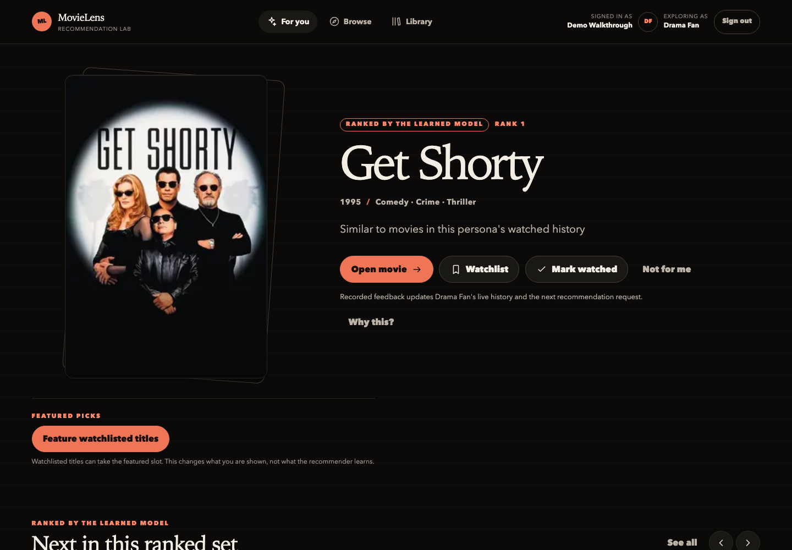

# MovieLens RecSys — Two-Stage Recommendation & MLOps

A **two-stage recommender system and MLOps platform** on **MovieLens 25M**. Hand-written **SASRec transformers**, two-tower/FAISS retrieval and route-specific **LightGBM LambdaRank** models share temporal evaluation and model-promotion contracts. Feast/Redis features, MLflow, Keycloak OIDC, PostgreSQL row-level security and an authenticated FastAPI service connect offline modeling to a **Next.js movie-discovery product** with durable prediction audits and an authenticated k6 latency gate.

[](https://github.com/kudratsingh/MovieLens-RecSys/actions/workflows/ci.yml)



## Model results

The established comparison uses a fixed temporal split and a 28-day holdout: **1,931 warm users** with at least ten training ratings, and **710 cold users**. These are single-training-seed measurements, not a completed multi-seed or multi-window study.

| Stage and metric | Model | Warm | Cold | Overall |
|---|---|---:|---:|---:|
| Retrieval · recall@500 | Item-item cosine | 0.3991 | 0.5263 | 0.4333 |
| Retrieval · recall@500 | SASRec v1 | 0.5092 | 0.5263 | 0.5138 |
| Retrieval · recall@500 | Two-tower v2 | 0.5113 | 0.5263 | 0.5153 |
| End to end · NDCG@10 | Item-item + LightGBM | 0.0728 | 0.5490 | 0.2008 |
| End to end · NDCG@10 | SASRec + one LightGBM ranker per route | 0.1014 | 0.5490 | 0.2218 |

SASRec and two-tower improve warm retrieval by **27.6%** and **28.1%** over item-item. The route-specific SASRec ranking bundle improves overall NDCG@10 by **10.4%**. Cold users receive the same popularity fallback, so identical cold metrics are expected. Retrieval recall and final ranking quality measure different stages.

**The newer hand-written SASRec sweep reached 0.5413 warm recall@500** for cell D (width 128, two layers, history 200). Its CPU re-score reproduced the saved result. That is a single-seed point estimate: the comparison gate against SASRec v1 has not issued a verdict, and this model has not been promoted or evaluated as the served end-to-end bundle.

Sources: [recorded results](docs/results.md), [current status](docs/status/README.md), [transformer parity experiment](docs/model-planning/experiments/wo2-hand-written-transformer.md), [sweep and restore evidence](docs/model-planning/experiments/wo5-sweep-preservation.md).

## Try the product locally

Docker Engine with Compose v2. The demo does not need the full ratings dataset or host Python/Node.

```bash
cp .env.example .env
make demo-up
make demo-seed
make demo-smoke
```

Open [localhost:3001](http://localhost:3001) and sign in as **demo / demo**, a local-only seeded account. The demo uses the real Keycloak authorization-code + PKCE flow and a committed catalog snapshot. Warm personas use the pinned item-item + LightGBM bundle; the cold persona receives an explicitly labeled popularity fallback.

Discover, Browse, movie detail, Library and Quick Picks share the same authenticated API. “Why this?” exposes recommendation evidence, and `make demo-audits` shows the durable prediction records. TMDB artwork is optional; without its token the product uses generated artwork. [Walkthrough and troubleshooting](docs/demo-runbook.md).

## How the system works

```text
Offline: MovieLens → temporal split → features → retriever + ranker
         → evaluation gates → checksum-pinned model bundle

Online:  Keycloak token → tenant-scoped transaction → history routing
         → retrieval → Feast/Redis features → LightGBM ranking
         → durable prediction audit → response
```

- **Tenant isolation:** the tenant comes from the token issuer, with forced PostgreSQL row-level security and transaction-scoped tenant context.
- **Serving integrity:** a private sidecar checks bundle hashes and champion identity. Unavailable, cold or mismatched paths return a named fallback.
- **Auditability:** each prediction records items, scores, feature values, model and route versions, fallback reasons and stage timings before the response commits.
- **Model transparency:** hand-written causal attention, normalization and transformer blocks, with parity checks against the prior encoder.
- **Latency measurement:** the authenticated k6 gate requires p99 below 100 ms, correct responses, no request errors and at least 50 requests/s. Historical passing measurements apply to their recorded bundles and topologies, not to an unmeasured SASRec deployment.

The [architecture guide](docs/architecture.md), [transformer walkthrough](docs/modeling/transformer-from-scratch.md) and [latency protocol](docs/adr/0010-synthetic-load-k6.md) explain the mechanisms and tradeoffs.

## Current work and limits

The hand-written encoder and larger-model sweep are implemented. Phase A still owes the model-comparison verdict, the winner's end-to-end evaluation, headline training-seed/window replication and the final write-up. Serving changes, the SASRec champion swap, deployment and moderated frontend sessions remain parked behind that work.

**There is no public hosted deployment.** The production topology and release rehearsal exist, but the host has not been provisioned and the full-data serving-artifact directory is a placeholder until an approved bundle is published. The local demo has its own bundled fixture. Passing deployment/canary no-op workflows do not establish a live service.

## Development and documentation

Python **3.11+** for backend/model development; Node **22+** for the frontend. See the [development instructions](CLAUDE.md), [documentation index](docs/README.md) and [demo runbook](docs/demo-runbook.md) for the relevant environment.

| Area | Entry point |
|---|---|
| Retrievers and hand-written transformer | [src/models/candidates](src/models/candidates/) |
| Training and temporal evaluation | [training](src/training/), [evaluation](src/evaluation/) |
| Online API and model serving | [src/serving](src/serving/) |
| Product | [web](web/), [frontend guide](docs/frontend/README.md) |
| Research sequence | [Modeling roadmap](docs/modeling-roadmap.md), [Phase A](docs/model-planning/phase-a-work-orders.md) |
| Results and operational limits | [Results](docs/results.md), [status](docs/status/README.md), [deployment runbook](docs/deployment-runbook.md) |

## License

All rights reserved; no license is granted for this repository's code. MovieLens data and TMDB metadata retain their respective source terms; see [dataset notes](docs/eda.md) and [TMDB metadata provenance](docs/data/tmdb-metadata.md).
